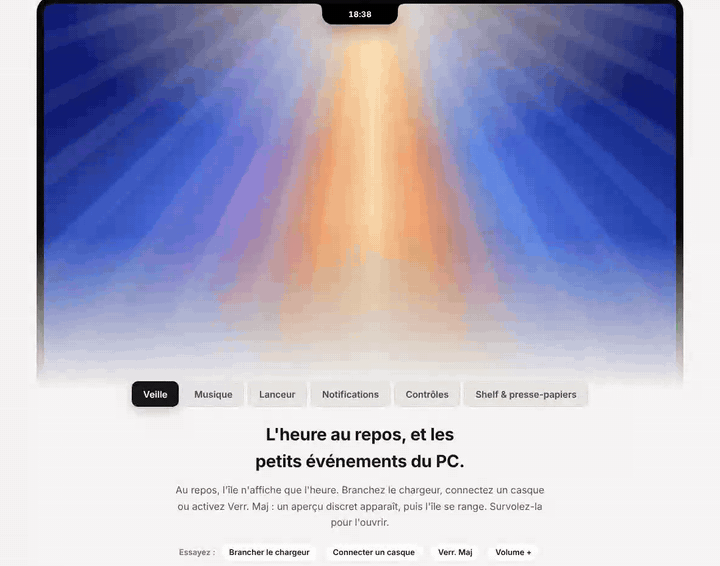

<div align="center">
    
    <p>
      
      
      <a href="LICENSE"></a>
    </p>
  
  [Website](https://quiera.eu/) • [Download](https://github.com/quierapro/quiera-island/releases/latest/download/Quiera-Setup-x64.exe) • [Support](https://github.com/quierapro/quiera-island/issues)
</div>

# Quiera

An island at the top of your screen for media, quick controls and live activities. Built for Windows 11 first.

<p align="center">
  
</p>

> [!NOTE]
> **Early development.** Expect rough edges and breaking changes between releases.

## Features

**At a glance**
- **Clock & media**: shows the time at rest and what is playing (Spotify, browsers and any app using Windows media controls), with synced lyrics and a player adapted from Bloom.
- **Peeks**: short announcements for the charger, a new audio output (with headphone battery when Windows reports it), Caps Lock and volume.
- **Notifications**: shown on the island (quietly in Do not disturb). Links open and a click opens the app.

**Tabs**
- **Shelf**: drop files on the island, drag them out again later, or send them to a phone: a QR code opens them on the local network (any phone, no app, link valid 10 minutes), or Windows' Share panel.
- **Clipboard**: keeps what you copied during the session. Never written to disk, and copies marked private by password managers are skipped.
- **Controls**: Wi-Fi, Bluetooth, audio output, master and per-app volume.

**Launcher** (<kbd>Alt</kbd>+<kbd>Space</kbd>)
- Finds apps and files on every drive, by name or by kind ("images", "videos").
- Computes and searches the web.

**Behaves well**
- Every setting applies at once: start with Windows, screen, hover, shortcut, lyrics, each module and peek.
- Steps aside for fullscreen apps, follows display changes and recovers from web view crashes.
- Updates itself when you say so: new versions are announced on the island and checked against a signature before they install.

> Windows does not let other apps reply to a notification or press its buttons, so Quiera can only open them.

## Development

Requirements: Windows 11, [Rust](https://rustup.rs) stable, Node.js 20+, pnpm 10.

```sh
pnpm install
pnpm tauri dev      # run the app
pnpm test           # frontend unit tests (Vitest)
pnpm build          # typecheck + frontend build
cd src-tauri
cargo test          # backend unit tests
cargo clippy --all-targets -- -D warnings
```

## Layout

| Path | Contents |
|---|---|
| `src/` | Frontend (React, TypeScript) |
| `src-tauri/src/` | Backend (Rust) |
| `src-tauri/src/platform/` | Everything OS-specific, one module per platform |
| `docs/` | Design and planning documents (French) |

The design documents explain the choices behind the project:
[analysis and plan](docs/01-analyse-et-plan.md) and
[decisions, design and features](docs/02-decisions-design-fonctionnalites.md).

## Code signing policy

Free code signing provided by [SignPath.io](https://about.signpath.io), certificate by [SignPath Foundation](https://signpath.org).

- Committers and reviewers: [quierapro](https://github.com/quierapro); pull requests from other people are reviewed before they are merged.
- Approvers: [quierapro](https://github.com/quierapro).

Installers are built by GitHub Actions from the tagged commit of this repository. Details, and what Quiera sends over the network (lyrics lookup, update check), are in the [code signing policy](https://quiera.eu/code-signing/) and the [privacy policy](https://quiera.eu/confidentialite/).

## License

GPL-3.0-or-later. See [LICENSE](LICENSE) and [THIRD_PARTY_NOTICES.md](THIRD_PARTY_NOTICES.md).
